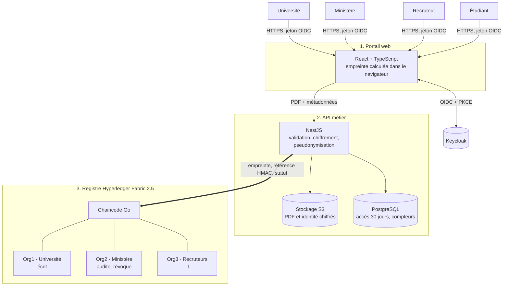

# Registre des diplômes sur blockchain

Plateforme de délivrance et de vérification de diplômes universitaires adossée à **Hyperledger Fabric**.
L'université inscrit l'empreinte de chaque diplôme dans un registre partagé avec le ministère et les recruteurs ;
n'importe quel recruteur peut ensuite confirmer en quelques secondes qu'un document est authentique et n'a pas été
révoqué, sans contacter la scolarité.

> Projet réalisé dans le cadre du Master SNIA, Université Mohammed V de Rabat.

## Le problème

Un diplôme papier ou PDF se falsifie facilement, et sa vérification repose sur un échange manuel avec
l'établissement : lent, coûteux, souvent abandonné. Une base de données centrale ne règle pas la question de
confiance : l'organisme qui la détient peut modifier l'historique sans que les autres parties le sachent.

## Le principe

| Donnée | Où elle vit | Pourquoi |
| --- | --- | --- |
| Empreinte SHA-256 du PDF, statut, historique | Registre Fabric, répliqué chez chaque organisation | Aucune partie ne peut le modifier seule |
| PDF du diplôme, identité du titulaire | Stockage S3, **chiffrés** en AES-256-GCM | Effaçables, jamais exposés sur la chaîne |
| Référence de l'étudiant sur la chaîne | HMAC-SHA256 de son identifiant | Pseudonyme : non rattachable à une personne sans un secret détenu par l'université |
| Comptes et rôles | Keycloak (OpenID Connect) | Authentification standard, aucun mot de passe géré par l'application |

Un seul octet modifié dans le PDF change son empreinte : la vérification échoue immédiatement.

## Architecture



| Acteur | Peut |
| --- | --- |
| **Université** | émettre un diplôme, le révoquer avec un motif, consulter le registre et son historique |
| **Ministère** | auditer tout le registre, révoquer, suivre l'activité sur un tableau de bord |
| **Recruteur** | vérifier un diplôme par identifiant de transaction (QR code) ou en déposant le PDF reçu |
| **Étudiant** | consulter ses diplômes, les télécharger, créer un lien de partage à durée limitée |

Le contrôle d'accès est appliqué deux fois : par l'API (rôles du jeton) et par le chaincode lui-même (identité
X.509 de l'organisation appelante). Une API compromise ne peut pas écrire à la place de l'université.

## Technologies

| Couche | Choix |
| --- | --- |
| Registre | Hyperledger Fabric 2.5.16, orderers Raft, CouchDB, chaincode Go (`fabric-contract-api-go` v2) |
| API | Node.js 20, NestJS 10, Fabric Gateway SDK, PostgreSQL 16, stockage compatible S3 |
| Portail | React 18, TypeScript, Vite, keycloak-js |
| Identité | Keycloak 24, OpenID Connect, Authorization Code + PKCE S256 |
| Standards | Open Badges 3.0 / W3C Verifiable Credentials 2.0, WCAG 2.2 AA |

## Structure du dépôt

```
university-blockchain/
├── frontend/university-portal/   # portail web (couche 1)
├── backend/diploma-api/          # API NestJS, realm Keycloak, docker-compose (couche 2)
├── blockchain/                   # réseau Fabric : configuration, docker, scripts (couche 3)
├── chaincode/diplomacontract/    # smart contract Go et index CouchDB
├── security/                     # politique d'endossement ; certificats générés (non versionnés)
└── deployment/Makefile           # raccourcis de déploiement du réseau
```

Chaque dossier a son propre `README.md` avec le détail.

## Démarrage rapide (sans réseau Fabric)

Le mode simulé remplace le registre par un équivalent en mémoire : idéal pour découvrir l'interface.

**Prérequis :** Docker, Node.js 20 ou plus récent.

```bash
git clone <url-du-depot> university-blockchain
cd university-blockchain/backend/diploma-api
cp .env.example .env
```

Générez les trois secrets et ajoutez-les au `.env`, avec les mots de passe locaux et le mode simulé :

```bash
for k in ENCRYPTION_KEY_HEX STUDENT_REF_PEPPER SHARE_TOKEN_SECRET; do
  sed -i "s/^$k=.*/$k=$(openssl rand -hex 32)/" .env
done
sed -i 's/^FABRIC_MOCK=.*/FABRIC_MOCK=true/' .env
cat >> .env <<'EOF'
KEYCLOAK_DB_PASSWORD=choisissez-un-mot-de-passe
KEYCLOAK_ADMIN_PASSWORD=choisissez-un-mot-de-passe
EOF
```

Remplacez aussi `MINIO_SECRET_KEY=change-me-minio` par une valeur de votre choix.

Puis :

```bash
docker compose up -d                 # stockage S3, Keycloak, boîte e-mail de test, PostgreSQL
npm install && npm test              # 43 tests
npm run start:dev                    # API sur http://localhost:3000
```

Dans un second terminal :

```bash
cd university-blockchain/frontend/university-portal
cp .env.example .env
npm install && npm run dev           # portail sur http://localhost:5173
```

| Service | Adresse |
| --- | --- |
| Portail | http://localhost:5173 |
| API (documentation Swagger) | http://localhost:3000/docs |
| État des dépendances | http://localhost:3000/health/ready |
| Console Keycloak (realm `university`) | http://localhost:8080 |
| Boîte e-mail de test | http://localhost:8025 |

### Comptes de démonstration

Créés par l'import du realm, **pour le développement uniquement**. Mot de passe : `Diplome#2026`.

| Identifiant | Rôle |
| --- | --- |
| `univ1` | Université |
| `ministere1` | Ministère |
| `recruteur1` | Recruteur |
| `D130012345` | Étudiant |

Pour tester l'accès étudiant de bout en bout : émettez un diplôme avec `univ1`, puis faites une demande sur
`/request-access` avec les mêmes informations. Le lien de connexion arrive sur http://localhost:8025.

## Avec le réseau Hyperledger Fabric

**Prérequis supplémentaires :** Go 1.21 ou plus récent, binaires et images Fabric **2.5.16**
(2.5.15 au minimum avec Docker Engine 29).

```bash
cd ~ && curl -sSLO https://raw.githubusercontent.com/hyperledger/fabric/main/scripts/install-fabric.sh
chmod +x install-fabric.sh && ./install-fabric.sh --fabric-version 2.5.16 docker samples binary

cd university-blockchain/blockchain/scripts
./network.sh all       # certificats, 3 orderers, 3 peers, canal, chaincode, test, connexion de l'API
```

`network.sh all` passe aussi `FABRIC_MOCK=false` dans le `.env` de l'API et y inscrit les chemins des certificats.
Redémarrez l'API, puis vérifiez que `checks.fabric` vaut `true` sur `/health/ready`.

## Sécurité

- **Aucun secret côté client.** Le portail ne connaît que des adresses publiques et la clé *publique* Turnstile ;
  les clés de chiffrement, le poivre de pseudonymisation et le secret du compte de service restent dans le `.env`
  de l'API.
- **Accès étudiant par e-mail.** Les informations saisies sont recoupées avec le dossier ; le lien de connexion part
  vers l'adresse enregistrée par l'université. Connaître l'état civil d'un étudiant ne suffit pas à prendre son compte.
  L'accès dure 30 jours, puis le compte se verrouille automatiquement.
- **Anti-robot.** Champ piège invisible, Cloudflare Turnstile vérifié côté serveur, limitation de débit.
- **Transport.** HTTPS forcé, HSTS (2 ans, preload), CSP restrictive, sur le portail comme sur l'API.
- **Jetons.** Signature RS256, émetteur, expiration et client émetteur (`azp`) vérifiés à chaque requête.
- **Démarrage refusé** en production si la configuration est incomplète : registre simulé, HTTP, clé de test ou
  secret d'exemple.

Pour signaler une vulnérabilité, merci de ne pas ouvrir de ticket public : contactez l'auteur directement.

## Données personnelles

Une blockchain n'efface rien ; le droit à l'effacement existe. Aucune donnée personnelle n'est donc écrite sur la
chaîne. À une demande d'effacement, l'identité chiffrée hors chaîne est supprimée : la référence HMAC qui reste dans
le registre ne désigne alors plus personne, tandis que le fait qu'un diplôme a été délivré est conservé.
Le détail figure dans la politique de confidentialité du portail (`/privacy`).

## Mise en production

`backend/diploma-api/docker-compose.prod.yml` lance la pile derrière un reverse proxy TLS : Keycloak en mode
`start`, sans comptes de test ; conteneur de l'API en lecture seule ; aucune base exposée sur l'hôte.
Points d'attention avant toute mise en ligne :

1. Générer tous les secrets, et conserver `ENCRYPTION_KEY_HEX` et `STUDENT_REF_PEPPER` **dans un coffre séparé** :
   sans eux, les sauvegardes sont illisibles.
2. Planifier les sauvegardes du stockage (`npm run backup:storage`) et des bases PostgreSQL (`pg_dump`).
3. Faire valider les pages légales par le délégué à la protection des données, puis passer `VITE_LEGAL_DRAFT=false`.
4. Remplacer le domaine d'exemple dans `sitemap.xml`, `robots.txt` et la CSP de `nginx.conf`.

## Tests

```bash
cd backend/diploma-api && npm test        # validation, chiffrement, recoupement d'identité, persistance, statistiques
cd frontend/university-portal && npm run build
cd chaincode/diplomacontract && CGO_ENABLED=0 go vet ./...
```

## Limites connues

- Les justificatifs Open Badges ne sont pas signés : leur authenticité repose sur l'empreinte inscrite dans le
  registre, pas sur une signature du fichier.
- Le réseau Fabric fourni fait tourner les trois organisations sur une seule machine ; en production, chaque
  organisation héberge ses propres nœuds.
- Une seule université par déploiement.
- L'application mobile prévue au schéma d'origine n'est pas incluse.

## Auteur

**Aboubacar Sacko** - Master SNIA, Université Mohammed V de Rabat.
